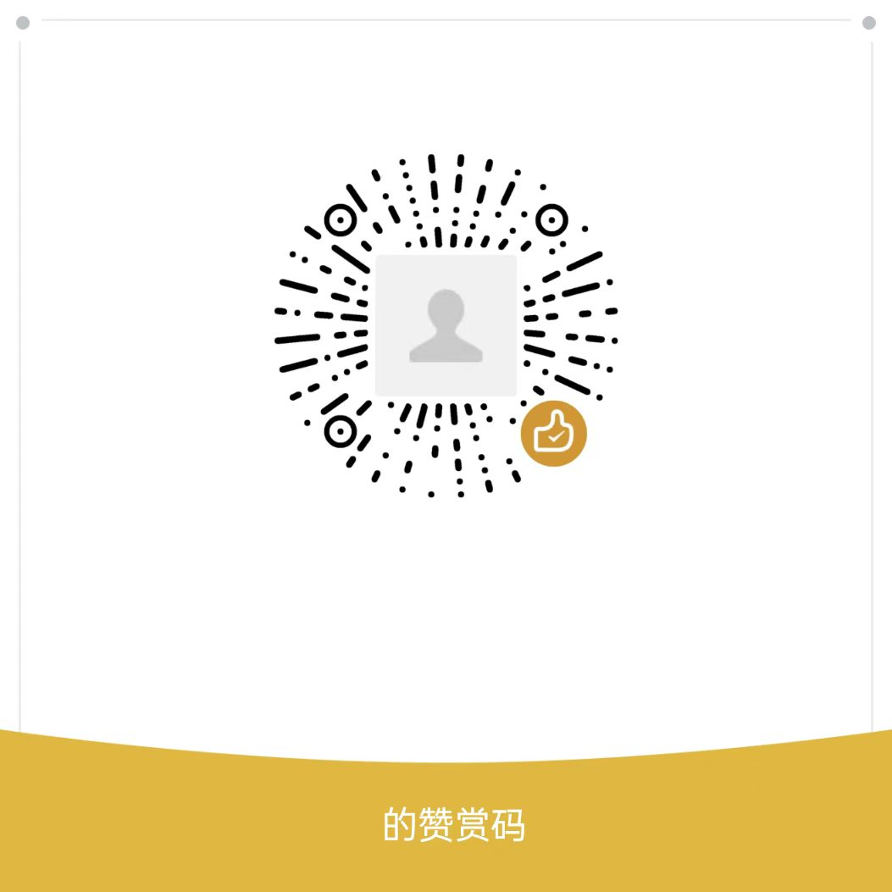

# 水到渠成

基于 Vue 3、Element Plus 和 Go 的校园饮水 / 淋浴设备助手，提供电脑本地服务与 Android 客户端。

支持账号管理、小票查询、设备扫码与使用状态展示。Android 端通过 WebView 加载界面，并在应用内运行 Go 服务。

## 功能与进度

| 功能     | 当前状态                                                   |
| -------- | ---------------------------------------------------------- |
| 账号管理 | 短信登录、身份回查、多账号切换、本机加密保存               |
| 小票查询 | 按校区展示余额，平台金额由分转换为元                       |
| 设备管理 | 扫码解析设备、保存设备、查询状态和服务费率                 |
| 启动使用 | 卡片内选择服务，启动前获取真实位置并检查状态，防止重复提交 |
| 使用过程 | 展示启动中、使用中、结束中等状态，动态更新使用时长         |
| 结束使用 | 仅对支持远程结束且已确认属于当前助手会话的设备开放         |
| 关于页面 | 项目仓库、赞助、使用说明和联系方式                         |


## 本地运行

电脑端需要 Node.js 22+、npm 10+ 和 Go 1.23+。在项目根目录执行：

```sh
npm ci
npm run build:web
npm run build:backend
npm start
```

启动后访问 [本机页面](http://127.0.0.1:18080)。开发前端时，可保持后端运行，另开终端执行 `npm run dev`。

后端默认仅监听本机回环地址，端口可通过 `PANGUAI_PORT` 设置。账号和密钥保存在本机 `data/` 目录；一个数据目录只由一个后端进程使用。

**公开源码不包含私有平台配置。** 缺少 `data/platform.json` 时，电脑服务可以启动，但真实登录及平台业务不可用；完整 Android 打包也需要该文件。请在本机准备配置，不要将真实配置、账号或密钥提交到仓库。

## Android 打包

现有 Android 构建脚本面向 Windows，需要 PowerShell（优先使用 7，也支持 Windows 自带的 5.1）、JDK 17、Android SDK 36、NDK 28.2.13676358 和 Gradle 8.13。脚本复用已有工具，不自动安装系统依赖；其他电脑请配置工具路径。

| 环境变量                         | 用途                           |
| -------------------------------- | ------------------------------ |
| `PANGUAI_JAVA_HOME`              | JDK 路径                       |
| `PANGUAI_ANDROID_SDK`            | Android SDK 路径               |
| `PANGUAI_GRADLE`                 | Gradle 可执行文件              |
| `PANGUAI_ANDROID_REFERENCE_ROOT` | 可选的参考工具目录             |
| `PANGUAI_POWERSHELL`             | 可选的 PowerShell 7 可执行文件 |

依赖安装完成、工具路径和本机平台配置准备好后，在根目录执行：

```sh
npm run build
```

完整构建依次执行 Go 测试与 vet、前端类型检查与生产构建、电脑 Go 构建、Android Go 动态库构建和 APK 打包。默认生成用于实机测试的 debug APK，不自动安装到手机。

| 产物           | 位置                                       |
| -------------- | ------------------------------------------ |
| 前端           | `dist/web/`                                |
| 电脑后端       | `dist/backend/panguai-api.exe`（Windows）  |
| Android 安装包 | `release/Android/水到渠成-0.4.4-debug.apk` |

版本号、显示名称及 Android versionCode 在根目录 `package.json` 管理。完整构建成功后会打印 `APK ready` 和绝对路径；构建失败时，请勿将目录里已有的旧 APK 当作本次产物。

Android 包含运行所需的平台协议配置，不包含电脑账号、账号密钥、MCP 令牌或本机代理配置。

## 常用命令

| 命令                         | 作用                                       |
| ---------------------------- | ------------------------------------------ |
| `npm run dev`                | 启动前端开发服务，代理本机 Go API          |
| `npm start`                  | 运行已构建的电脑后端及前端                 |
| `npm run check`              | 前端类型检查、Go 测试与 vet                |
| `npm run format`             | 格式化前端和 Node 构建脚本                 |
| `npm run format:check`       | 校验代码格式                               |
| `npm run check:ui`           | 使用模拟 API 和本机 Edge 检查界面          |
| `npm run build:web`          | 仅构建前端                                 |
| `npm run build:backend`      | 校验并构建电脑后端                         |
| `npm run build:android`      | 校验并打包 Android，包含前端和内嵌 Go      |
| `npm run build -- --offline` | 使用已有依赖缓存完成打包                   |
| `npm run clean`              | 清除生成产物，保留本机账号、密钥和研究材料 |


```sh
git status --short --untracked-files=all
git add --dry-run .
```

确认清单中没有本机数据或密钥再暂存、提交。`.gitignore` 只对未跟踪文件生效，已经提交过的敏感文件需要另行处理；不要使用 `git add -f` 强制加入这些目录。

## 项目结构与文档

```text
frontend/src/       页面、组件、业务流程、API 客户端与样式
frontend/public/    随应用打包的静态资源和赞赏码
backend/cmd/       电脑与 Android 启动入口
backend/internal/  HTTP API、平台适配、加密存储和构建版本
android/           Android WebView、相机和定位桥接
scripts/           构建、启动、清理与界面检查
docs/              架构、API 与界面说明
```

- [项目架构](docs/architecture.md)
- [Android 构建与运行](docs/android.md)
- [登录 API](docs/login-api.md)
- [设备使用 API](docs/device-use-api.md)
- [当前界面说明](docs/design/ui-current.md)

## 使用说明

请仅使用本人账号及有权操作的设备，遵守平台使用规则。软件免费提供，禁止售卖、付费分发或以激活、解锁功能等名义收费。遇到设备状态或结算异常时，请在官方 App 或设备端核对。

## 支持项目

如果这个项目对你有帮助，欢迎自愿打赏，支持后续维护。软件免费使用，打赏不解锁额外功能，也不影响现有功能使用。

<p align="center">
  
</p>

使用微信扫一扫，或保存图片后在微信中识别。感谢支持！

问题反馈请通过仓库 Issues，或加入 QQ 交流群：**345353411**。
